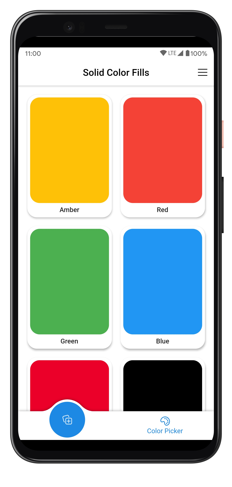
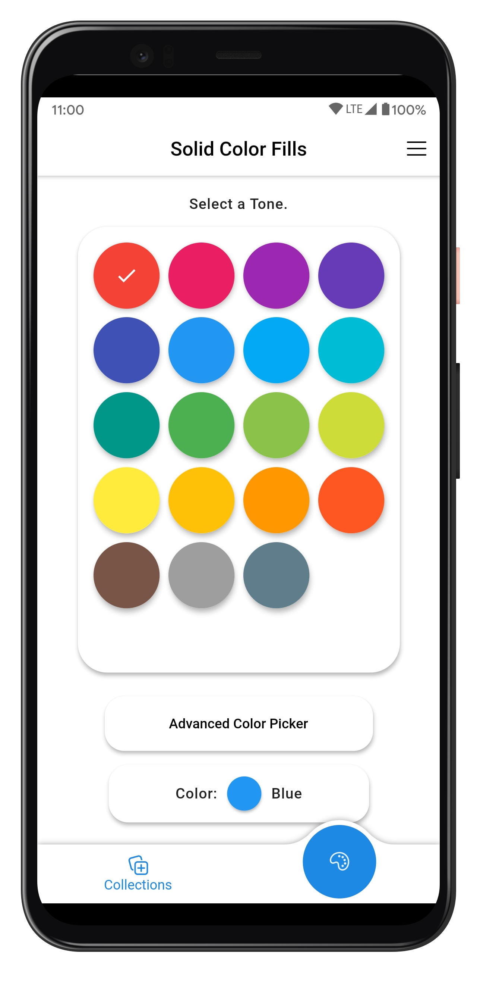
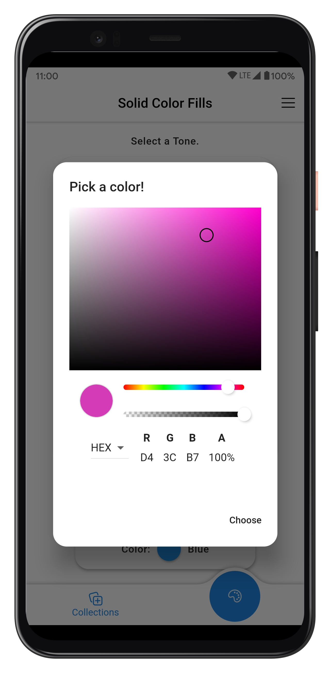
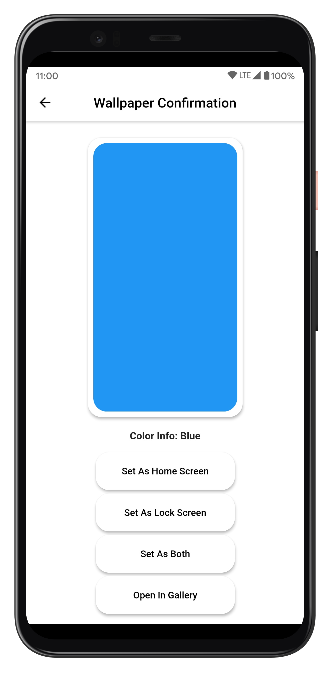
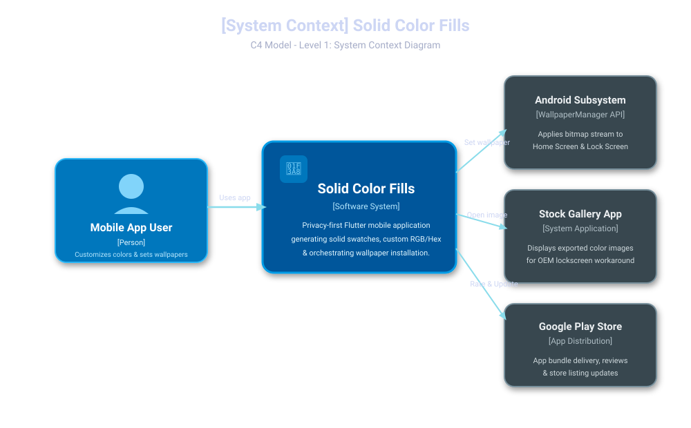
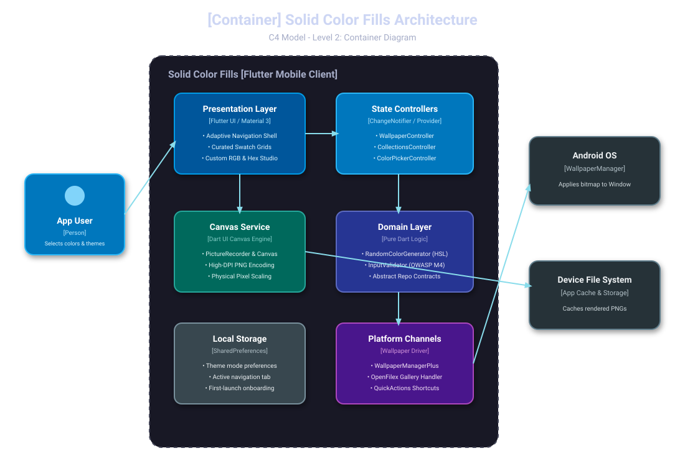
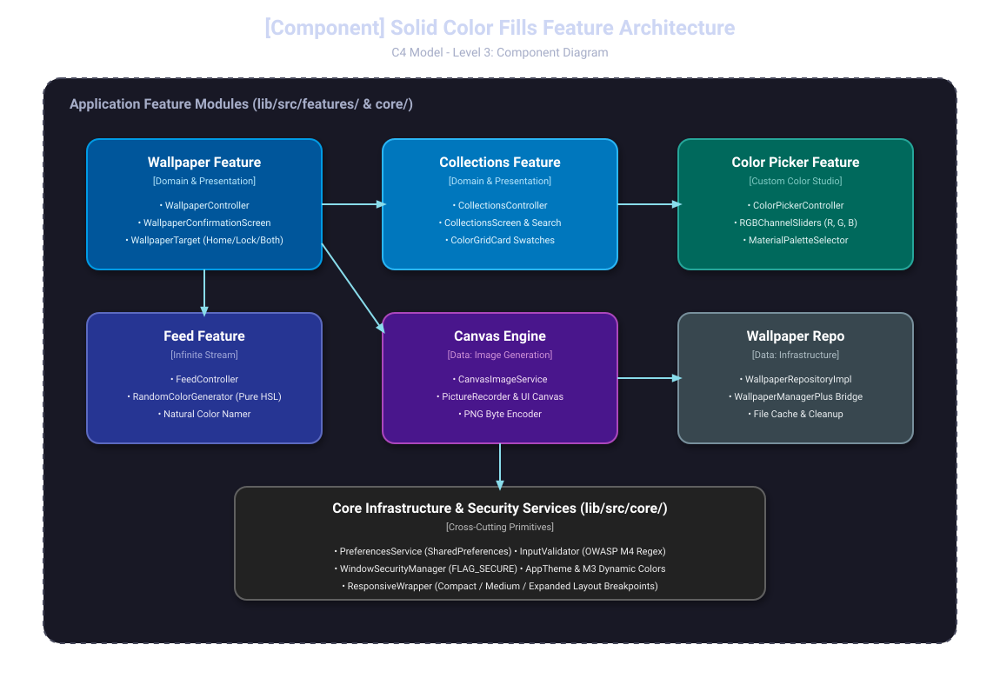
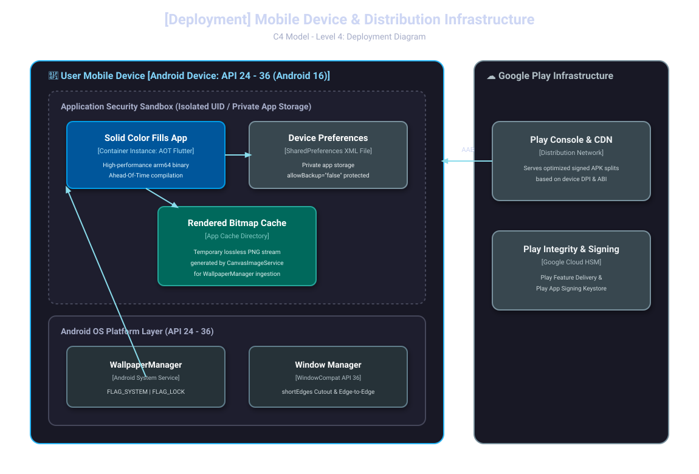

# Solid Color Fills 🎨

[](https://flutter.dev)
[-brightgreen.svg)](https://developer.android.com)
[](https://owasp.org/www-project-mobile-top-10/)
[](LICENSE)

An Open-Source app that can set your favourite color as Home-screen or Lockscreen Wallpaper. **Make your device colorful using Solid Color Fills!**

---

## 📱 Screenshots

| Collections | Color Picker |
|:---:|:---:|
|  |  |

| Advanced Color Picker | Wallpaper Selection |
|:---:|:---:|
|  |  |

---

## ✨ Features

* **Set any Solid Color as your Device Wallpaper**: Set crisp, uniform solid colors to Home Screen, Lock Screen, or both.
* **Open Source and Privacy Friendly**: Zero analytics, zero tracking, zero telemetry. All operations run strictly on-device.
* **Minimalistic and Pleasant UI**: Clean Material 3 adaptive design with edge-to-edge Android 15 & 16 integration.
* **Theme Modes**: Seamlessly toggle between Light, Dark, or System Default themes with custom entrance animations.
* **Cherry-Picked Curated Colors**: Handpicked collections tailored for AMOLED, OLED, and modern mobile displays.
* **Advanced Color Pickers**: Custom Color Studio with interactive RGB channel sliders, Material Design swatches, and exact Hex code input.
* **Infinite Random Color Feed**: Algorithmically generate vibrant, aesthetic solid colors on the fly with automatic descriptive naming.
* **Flexible Export Options**: Set directly via native WallpaperManager or export high-resolution canvas renders directly to your device Gallery.
* **Multi-Device Responsive**: Zero overflow errors from compact screens (320x568) to standard phones, foldables, tablets, and desktop/TV displays.
* **Built with Latest Flutter & Android 16**: Upgraded to Flutter 3.51, Android API 36 (targetSdk 36, compileSdk 36), and strict analysis mode.

---

## 📦 Download

<a href='https://play.google.com/store/apps/details?id=com.makeshtech.solid_color_fills&pcampaignid=pcampaignidMKT-Other-global-all-co-prtnr-py-PartBadge-Mar2515-1'></a>

---

## 🏛️ C4 Architecture Diagrams

The architecture of Solid Color Fills is modeled using the **C4 Model** and documented in [`.docs/architecture/`](.docs/architecture/).

### 1. System Context Diagram (Level 1)
Shows the high-level boundary of Solid Color Fills, primary actors, and external system integrations.



### 2. Container Diagram (Level 2)
Illustrates the major architectural containers within the Flutter application and external Android platform services.



### 3. Component Diagram (Level 3)
Details the internal structure of feature modules (`lib/src/features/`) and core services.



### 4. Deployment Diagram (Level 4)
Documents the client mobile device security sandbox, local device persistence, and Android platform execution.



---

## 📐 Engineering & Architecture Principles

- **SOLID Design Principles**: Single responsibility classes, open/closed wallpaper evaluators, substitutable repository contracts, segregated interfaces, and dependency inversion.
- **Feature-First Clean Architecture**: Clean separation between **Domain** (pure Dart business logic), **Data** (canvas encoding, SharedPreferences & platform channels), and **Presentation** (Material 3 widgets & reactive controllers).
- **Complexity Guardrails**: Cognitive and cyclomatic complexity are kept strictly bounded; monolith methods are refactored into focused strategy delegates and transformers.
- **Architecture Decision Records (ADRs)**: Stored in Michael Nygard format under [`.docs/adr/`](.docs/adr/).
- **AI Agent Guidelines**: Detailed operations manual and skills defined in [`AGENTS.md`](AGENTS.md) and [`.agents/`](.agents/).

---

## 🏗️ Directory Layout

```text
lib/src/
├── core/             # Cross-cutting primitives (theme, storage, security, constants, utils)
└── features/         # Decoupled domain, data, and presentation layers
    ├── collections/  # Curated solid color palette browsing
    ├── color_picker/ # RGB channel sliders & hex picker studio
    ├── feed/         # Infinite random color generation
    ├── home/         # Navigation shell & convex bottom navigation
    ├── onboarding/   # First-launch introductory walkthrough
    ├── settings/     # Theme selection, about, troubleshooting
    ├── shortcuts/    # Android Quick Actions integration
    └── wallpaper/    # Canvas rendering engine & Android WallpaperManager
```

---

## 📝 Notes

Set as Lock Screen wallpaper does not work in some OEM systems (like MIUI, Realme OS, ColorOS, etc.) due to system-level manufacturer restrictions blocking third-party wallpaper APIs. In such scenarios, tap **"Open in Gallery"** and set the wallpaper directly using your device's stock/system Gallery app.

---

## 🧪 Building and Verification

### Prerequisites
- Flutter SDK 3.51+
- Android SDK 36 (Android 16)
- Java 17

### Static Analysis & Tests
```bash
# Verify static analysis (strict mode)
flutter analyze

# Execute all unit, widget, and responsive layout tests
flutter test

# Scan for PII and secrets before committing
dart run .agents/skills/conventional-commit/bin/scan_pii.dart
```

### Build Production App Bundle (AAB)
```bash
flutter build appbundle --release --obfuscate --split-debug-info=build/app/outputs/symbols
```

---

## 💖 Support Me

Motivate me by downloading the app directly from Play Store and please write a nice review, Thank you 😃

---

## 📜 Credits

* Icons made by [Freepik](https://www.freepik.com) from [www.flaticon.com](https://www.flaticon.com)
* App Screenshots created with [MockUPhone](https://mockuphone.com).
* Google Play and the Google Play logo are trademarks of Google LLC.

---

## 📄 License

This project is licensed under the MIT License - see the [LICENSE](LICENSE) file for details.
